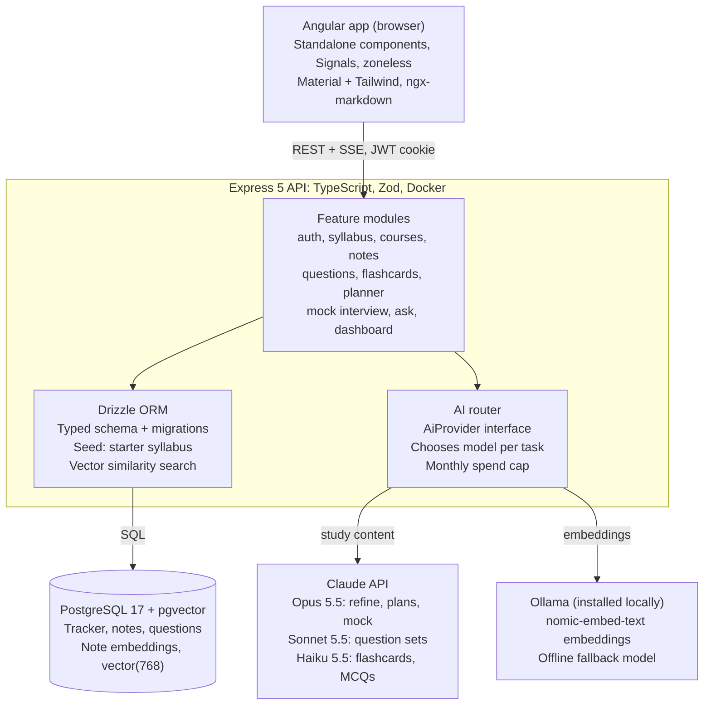
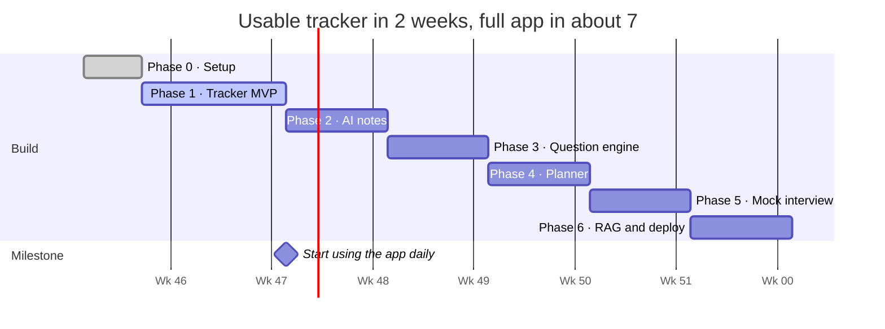

# Interview Prep Tracker — Full Project Plan

Last updated: 2026-11-19

## Contents

- [Overview](#overview)
- [Features](#features)
- [Syllabus (fully customisable)](#syllabus-fully-customisable)
- [Tech stack and architecture](#tech-stack-and-architecture)
- [AI strategy](#ai-strategy)
- [Database schema](#database-schema)
- [API design](#api-design)
- [Frontend structure](#frontend-structure)
- [Repo structure and dev setup](#repo-structure-and-dev-setup)
- [Roadmap](#roadmap)
- [Testing, CI/CD and deployment](#testing-cicd-and-deployment)
- [Risks, decisions and next steps](#risks-decisions-and-next-steps)

## Overview

A personal web app that tracks full-stack interview prep from HTML through to AI, turns my course notes into polished study material and interview questions, and plans and runs mock interviews. The first usable version (the tracker) ships in about 2 weeks; the full app in about 7 weeks part-time.

**Who it's for:** me, a frontend Angular developer with some backend and AI experience, preparing for frontend and full-stack roles.

**Goals**

1. One place to see exactly what I've covered, what's weak and what's next, across every track.
2. Turn raw notes from my purchased video playlists into clean, accurate revision material.
3. Practise with every type of interview question, plus realistic AI mock interviews.
4. Follow a study plan that adapts to my target date, my free hours and the job I'm applying for.

**Why it's worth building:** the app uses the same stack I'm interviewing for (Angular, Node, PostgreSQL, Docker, CI/CD, AI), so building it is prep in itself and becomes a portfolio project I can walk an interviewer through.

**Not in scope:** storing or streaming the purchased videos themselves (only my notes and links), multi-user or social features, a mobile app.

## Features

Ten modules; the first three make the MVP, the rest add AI and practice on top.

| #   | Module           | What it does                                                                                                                                                                                                                                                                                                        | Phase               |
| --- | ---------------- | ------------------------------------------------------------------------------------------------------------------------------------------------------------------------------------------------------------------------------------------------------------------------------------------------------------------- | ------------------- |
| 1   | Syllabus tracker | Fully editable Track → Module → Topic tree. Add any technology (React, Next.js…) from the catalog, with AI, or by hand; set a priority per track; switch target-role profiles. Each topic has a status (Not started, Learning, Revised, Interview-ready), a confidence rating from 1 to 5 and a last-reviewed date. | 1                   |
| 2   | Courses          | Add a purchased playlist, list its videos, link each video to one or more topics, mark videos watched. Stores only titles, links and my notes.                                                                                                                                                                      | 1                   |
| 3   | Notes            | Markdown editor with code highlighting. Upload `.md`, `.txt`, PDF or photos of handwritten notes. Notes attach to a topic and optionally a video.                                                                                                                                                                   | 1                   |
| 4   | AI note refine   | One click turns a raw note into a clean note: key points, code examples, gotchas, "X vs Y" comparisons, a Mermaid diagram and a 5-line summary. Original and refined versions kept side by side; the refined one is editable.                                                                                       | 2                   |
| 5   | Question engine  | Per topic: concept, output-prediction, coding, scenario, system design, follow-up chains, MCQ, behavioral. Tagged easy, medium or hard. Practice mode with self-rating.                                                                                                                                             | 3                   |
| 6   | Flashcards       | Cards generated from notes and questions, reviewed with spaced repetition (SM-2) so each card returns just before I'd forget it.                                                                                                                                                                                    | 3                   |
| 7   | Planner          | Ready-made templates (e.g. 6-week Angular-heavy) or an AI plan built from target date, hours per day and weak topics. Paste a job description to get a gap analysis and an adjusted plan. Plans cover only active tracks, weighted by priority, and offer a replan when tracks change. Daily to-do view.            | 4                   |
| 8   | Mock interview   | Chat with an AI interviewer on chosen topics and level. It asks follow-ups, scores each answer against a rubric and ends with a report. Voice later.                                                                                                                                                                | 5                   |
| 9   | Ask my notes     | Ask a question and get an answer built only from my own notes, with links to the notes it used (RAG over pgvector).                                                                                                                                                                                                 | 6                   |
| 10  | Dashboard        | Readiness % per track, study-streak heatmap, weakest topics, cards due today, and a one-page cheat sheet for the day before an interview.                                                                                                                                                                           | 1, grows each phase |

## Syllabus (fully customisable)

The syllabus is mine to shape: I can add any technology (React, Next.js, Vue, NestJS and so on), edit or archive any track, and the plan, questions and dashboard follow whatever is active. The app starts with this default Angular-focused syllabus as seed data: 7 tracks, 15 modules, 109 topics.

| Track       | Module                     | Example topics                                                                                                                                                                           |
| ----------- | -------------------------- | ---------------------------------------------------------------------------------------------------------------------------------------------------------------------------------------- |
| Web basics  | HTML                       | Semantic tags, forms and validation, accessibility (ARIA), SEO basics, meta tags                                                                                                         |
| Web basics  | CSS                        | Box model, specificity, Flexbox, Grid, positioning, responsive design, animations, BEM, SCSS                                                                                             |
| Web basics  | Browser and web            | Rendering pipeline, critical rendering path, storage (cookies, local, session), CORS, HTTP/HTTPS, caching, web security (XSS, CSRF)                                                      |
| JavaScript  | Core JS                    | Types and coercion, scope, hoisting, closures, `this`, prototypes, ES6+ features                                                                                                         |
| JavaScript  | Async JS                   | Event loop, microtasks vs macrotasks, promises, async/await, debounce and throttle                                                                                                       |
| JavaScript  | TypeScript                 | Types vs interfaces, generics, utility types, narrowing, decorators, `tsconfig`                                                                                                          |
| Angular     | Angular core               | Components, templates, control flow, data binding, lifecycle hooks, directives, pipes, DI                                                                                                |
| Angular     | Reactivity                 | Signals, `computed`, `effect`, `linkedSignal`, `resource`, RxJS operators, Subjects, Signals vs RxJS                                                                                     |
| Angular     | Angular advanced           | Change detection, OnPush, zoneless, routing and guards, lazy loading, forms (reactive, typed), HttpClient and interceptors, NgRx / signal store, SSR and hydration, performance, testing |
| Backend     | Node.js and Express        | Node event loop, streams, modules, Express middleware, routing, error handling, auth (JWT, sessions), REST design, validation                                                            |
| Backend     | Databases                  | SQL joins, indexes, transactions, normalisation, PostgreSQL, ORMs (Drizzle), NoSQL basics, Redis caching                                                                                 |
| DevOps      | Docker and CI/CD           | Dockerfile, images vs containers, Compose, multi-stage builds, GitHub Actions, environments, deployment                                                                                  |
| DevOps      | System design              | Frontend system design, scalability, caching layers, CDNs, load balancing, micro-frontends                                                                                               |
| AI          | AI for developers          | LLM basics, prompting, tokens and cost, structured output, embeddings, RAG, vector databases, AI in frontend apps                                                                        |
| Soft skills | Behavioral and soft skills | STAR answers, project walkthrough, conflict, ownership, "why this company"                                                                                                               |

**Three ways to add a technology**

1. **From the catalog:** pick a ready-made track (table below). It arrives with modules and topics I can edit.
2. **AI-generated:** type any technology name and my level (e.g. "Next.js, intermediate"). Claude drafts the modules and topics; I review and edit the preview before saving.
3. **By hand:** create the track, modules and topics myself.

**How the plan adapts**

- Each track has an **active** switch and a **priority** (High, Medium, Low). Archived or inactive tracks drop out of the plan, practice and readiness score.
- **Target-role profiles** are saved sets of active tracks, e.g. "Angular frontend", "React + Next.js frontend", "Full-stack (Angular + Node)". Switching profile switches the tracks in one click.
- The planner schedules only active tracks, weighted by priority and my confidence per topic. Adding, removing or reprioritising a track offers a **replan**, keeping finished work.
- Pasting a job description detects the technologies it names (e.g. React, Next.js) and offers to add the missing ones from the catalog or with AI, then replans.
- Notes, questions, flashcards and mock interviews hang off topics, so they work for any new track with no extra setup.

**Technology catalog (built in, editable)**

| Technology                | Modules included                                                                                                                                         |
| ------------------------- | -------------------------------------------------------------------------------------------------------------------------------------------------------- |
| React                     | JSX and components, hooks, state (Context, Redux Toolkit, Zustand), React Query, performance (memo, keys, re-renders), React 19 features, forms, testing |
| Next.js                   | App Router, Server vs Client Components, data fetching and caching, Server Actions, SSR / SSG / ISR, middleware, routing and layouts, deployment         |
| Vue + Nuxt                | Composition API, reactivity, Pinia, Vue Router, Nuxt rendering modes                                                                                     |
| NestJS                    | Modules, controllers, providers, DI, guards, pipes, interceptors                                                                                         |
| Fastify                   | Plugins, hooks, schema validation, performance vs Express                                                                                                |
| MongoDB                   | Documents and schema design, aggregation, indexes, Mongoose                                                                                              |
| GraphQL                   | Schemas, resolvers, Apollo Client, N+1 and DataLoader                                                                                                    |
| Kubernetes and cloud      | Pods, deployments, services, AWS basics (EC2, S3, Lambda)                                                                                                |
| Python + FastAPI          | Python basics, FastAPI routing, Pydantic, async                                                                                                          |
| AI engineering (advanced) | Agents and tool use, evals, fine-tuning basics, LangChain / LlamaIndex                                                                                   |
| DSA                       | Arrays, strings, hash maps, trees, graphs, Big-O, common patterns                                                                                        |

The catalog is stored as JSON seed files in the repo, so adding a new technology to it is one file.

## Tech stack and architecture

Every layer uses a technology on my interview list, all in TypeScript, all running in Docker.

| Layer    | Choice                                                                                  | Why                                                       |
| -------- | --------------------------------------------------------------------------------------- | --------------------------------------------------------- |
| Frontend | Angular (latest), standalone components, Signals, zoneless, Angular Material + Tailwind | My main interview stack; practises modern Angular         |
| Backend  | Node.js 22 LTS, Express 5, TypeScript, Zod                                              | Express comes up most in interviews and job descriptions  |
| Database | PostgreSQL 17, Drizzle ORM, pgvector                                                    | Relational data plus vector search in one database        |
| AI       | Anthropic TypeScript SDK (Claude), Ollama                                               | Premium quality for study material; free local embeddings |
| Auth     | JWT in httpOnly cookie, argon2 password hashing                                         | Simple and secure for a single user                       |
| Files    | Multer, local disk volume (S3-compatible later)                                         | Note uploads and photos                                   |
| DevOps   | Docker, Docker Compose, GitHub Actions, GitHub Container Registry                       | CI/CD practice on a real project                          |
| Testing  | Vitest, Supertest, Testcontainers, Playwright                                           | Unit to end-to-end                                        |



The browser only ever calls the Express API. Inside it, feature modules use Drizzle for data and the AI router for model calls, so swapping a model is a config change. Everything ships as Docker images; GitHub Actions lints, tests, builds and deploys on merge to `main`.

## AI strategy

Claude handles everything I study from; a local Ollama model handles embeddings and cheap background jobs. Accuracy matters most here, because a wrong answer I memorise can cost me in an actual interview.

**Provider layer.** The backend defines one `AiProvider` interface (`complete`, `completeJson`, `stream`, `embed`) with two implementations, `ClaudeProvider` (Anthropic TypeScript SDK) and `OllamaProvider`. A config map picks the provider and model per task, so models can be swapped without touching feature code.

| Task                                        | Provider and model                | Why                                            | Approx. cost each |
| ------------------------------------------- | --------------------------------- | ---------------------------------------------- | ----------------- |
| Refine a note                               | Claude Opus 5.5                   | Highest accuracy for material I study from     | ~$0.07            |
| Read handwritten notes (photo to text)      | Claude Opus 5.5                   | Strong vision                                  | ~$0.03            |
| Question set for a topic                    | Claude Sonnet 5.5                 | Good quality at half the price                 | ~$0.03            |
| Study plan and job-description gap analysis | Claude Opus 5.5                   | Multi-step reasoning                           | ~$0.05            |
| Mock interview (about 20 turns)             | Claude Opus 5.5                   | Realistic follow-ups and fair scoring          | ~$0.20–0.40       |
| Flashcards, MCQs, tags, summaries           | Claude Haiku 5.5                  | Cheap, high volume                             | ~$0.002           |
| Embeddings for Ask my notes                 | Ollama `nomic-embed-text`         | Claude has no embeddings API; free and private | $0                |
| Offline fallback                            | Ollama (`gemma4:e2b`, `llama3.2`) | Works without internet                         | $0                |

Costs are estimates from current list prices and typical note lengths. Expected total: about $5–15 a month with daily use.

**Accuracy safeguards**

- Every AI output is saved, editable and linked to the note it came from. Fix it once and it stays fixed; nothing is regenerated silently.
- Prompts tell the model to work only from my note plus well-established facts, and to flag anything it is unsure of with a "Verify" marker.
- Structured outputs (JSON schemas validated with Zod) for questions, flashcards and plans, so the UI never parses free text.
- A "Report wrong" button on any question or card marks it for review and excludes it from practice.
- A monthly spend cap in config; the app warns at 80% and stops AI calls at 100%.

**Prompts** live as versioned files in `apps/api/src/ai/prompts/`, one per task, so changes are tracked in Git.

## Database schema

PostgreSQL 17 with the `pgvector` extension, defined in Drizzle (`apps/api/src/db/schema/`), with migrations from `drizzle-kit`. All tables use `uuid` primary keys plus `created_at` and `updated_at`.

```
users ─┬─ tracks ── modules ── topics ─┬─ topic_progress
       │                                ├─ notes ── note_versions
       │                                │            └─ note_chunks (embedding vector)
       │                                ├─ questions ── question_attempts
       │                                └─ flashcards ── flashcard_reviews
       ├─ courses ── videos ── video_topics (many-to-many with topics)
       ├─ study_plans ── plan_days ── plan_tasks
       ├─ mock_interviews ── mock_turns
       ├─ uploads
       └─ ai_usage
```

| Table                           | Key columns                                                                                     | Notes                                             |
| ------------------------------- | ----------------------------------------------------------------------------------------------- | ------------------------------------------------- |
| `users`                         | email, password_hash, name, settings (jsonb)                                                    | Single user now; kept for auth and future sharing |
| `tracks` / `modules` / `topics` | name, slug, description, sort_order, parent id                                                  | The syllabus tree                                 |
| `topic_progress`                | topic_id, status (enum), confidence 1–5, last_reviewed_at, minutes_spent                        | One row per topic                                 |
| `courses`                       | title, provider, url, total_videos                                                              | A purchased playlist                              |
| `videos`                        | course_id, title, url, position, duration, watched_at                                           |                                                   |
| `video_topics`                  | video_id, topic_id                                                                              | Links videos to topics                            |
| `notes`                         | topic_id, video_id (nullable), title, source_type (typed, md, pdf, image)                       | The note record                                   |
| `note_versions`                 | note_id, kind (raw, refined), content_md, model, prompt_version                                 | Raw and refined kept side by side                 |
| `note_chunks`                   | note_version_id, chunk_text, embedding `vector(768)`                                            | For Ask my notes                                  |
| `questions`                     | topic_id, note_id, type (enum), difficulty, question, answer_md, follow_ups (jsonb), is_flagged |                                                   |
| `question_attempts`             | question_id, my_answer, self_rating, ai_score, ai_feedback                                      |                                                   |
| `flashcards`                    | topic_id, front, back, ease, interval_days, repetitions, due_at                                 | SM-2 fields                                       |
| `flashcard_reviews`             | flashcard_id, grade 0–5, reviewed_at                                                            |                                                   |
| `study_plans`                   | title, target_date, hours_per_day, source (template, ai, jd), jd_text                           |                                                   |
| `plan_days` / `plan_tasks`      | date, topic_id, task_type, est_minutes, done_at                                                 |                                                   |
| `mock_interviews`               | topics, level, status, overall_score, report_md                                                 |                                                   |
| `mock_turns`                    | interview_id, role, content, score, feedback                                                    |                                                   |
| `uploads`                       | file_name, mime, size, storage_path, extracted_text                                             |                                                   |
| `ai_usage`                      | task, provider, model, input_tokens, output_tokens, cost_usd                                    | Powers the spend cap                              |

**Added for a customisable syllabus**

| Table or column        | Key columns                                                                        | Notes                                                        |
| ---------------------- | ---------------------------------------------------------------------------------- | ------------------------------------------------------------ |
| `tracks` (new columns) | is_active, priority (enum), source (catalog, ai, manual), catalog_key, archived_at | Inactive or archived tracks are left out of plans and scores |
| `tech_catalog`         | key, name, category, version, template (jsonb: modules and topics)                 | Loaded from JSON seed files                                  |
| `profiles`             | name, description, is_current                                                      | Target roles, e.g. "React + Next.js frontend"                |
| `profile_tracks`       | profile_id, track_id, priority                                                     | Which tracks each profile switches on                        |

## API design

REST over JSON under `/api/v1`, validated with Zod, authenticated with a JWT in an httpOnly cookie. Long AI responses (refine, mock interview) stream over Server-Sent Events.

| Module         | Endpoints                                                                                                                                                                                               |
| -------------- | ------------------------------------------------------------------------------------------------------------------------------------------------------------------------------------------------------- |
| Auth           | `POST /auth/register`, `POST /auth/login`, `POST /auth/logout`, `GET /auth/me`                                                                                                                          |
| Syllabus       | `GET /tracks` (full tree with progress), `POST/PATCH/DELETE /tracks/:id`, same for `/modules/:id` and `/topics/:id`, `PATCH /topics/:id/progress`, `PATCH /topics/reorder`                              |
| Courses        | `GET/POST /courses`, `GET/PATCH/DELETE /courses/:id`, `POST /courses/:id/videos` (bulk paste), `PATCH /videos/:id` (watched, linked topics)                                                             |
| Notes          | `GET /notes?topicId=`, `POST /notes`, `GET/PATCH/DELETE /notes/:id`, `POST /uploads` (multipart)                                                                                                        |
| AI refine      | `POST /notes/:id/refine` (SSE stream), `GET /notes/:id/versions`, `PATCH /note-versions/:id`                                                                                                            |
| Questions      | `POST /topics/:id/questions/generate` (body: types, count, difficulty), `GET /questions?topicId=&type=&difficulty=`, `PATCH /questions/:id`, `POST /questions/:id/attempts`, `POST /questions/:id/flag` |
| Flashcards     | `POST /topics/:id/flashcards/generate`, `GET /flashcards/due`, `POST /flashcards/:id/review` (grade 0–5)                                                                                                |
| Planner        | `GET /plan-templates`, `POST /plans` (from template), `POST /plans/ai` (target date, hours, weak topics), `POST /plans/jd` (job description), `GET /plans/:id/today`, `PATCH /plan-tasks/:id`           |
| Mock interview | `POST /mock-interviews`, `POST /mock-interviews/:id/answer` (SSE stream), `POST /mock-interviews/:id/finish`, `GET /mock-interviews/:id`                                                                |
| Ask my notes   | `POST /ask` (question; returns answer + cited notes)                                                                                                                                                    |
| Dashboard      | `GET /dashboard/summary`, `GET /dashboard/heatmap`, `GET /dashboard/cheatsheet?trackId=`                                                                                                                |
| AI usage       | `GET /ai/usage?month=`                                                                                                                                                                                  |

**Customisable syllabus endpoints:** `GET /catalog`, `POST /tracks/from-catalog/:key`, `POST /tracks/generate` (technology + level; returns an editable preview), `POST /tracks/generate/confirm`, `PATCH /tracks/:id` (active, priority, archive), `GET/POST /profiles`, `POST /profiles/:id/activate`, `POST /plans/:id/replan`, `POST /plans/jd/detect` (technologies found in a job description).

## Frontend structure

Angular with standalone components, Signals for state, zoneless change detection, lazy-loaded feature routes, and Angular Material with Tailwind for layout. Markdown is rendered with `ngx-markdown` (Mermaid and code highlighting) and edited in a CodeMirror editor.

| Route                      | Page                                                                         |
| -------------------------- | ---------------------------------------------------------------------------- |
| `/login`, `/register`      | Sign in, create account                                                      |
| `/dashboard`               | Readiness per track, streak heatmap, due cards, today's plan, weakest topics |
| `/syllabus`                | Collapsible track/module/topic tree with status chips and confidence stars   |
| `/syllabus/topic/:id`      | Topic hub: notes, questions, flashcards, linked videos, progress             |
| `/courses`, `/courses/:id` | Playlists and their videos with watched toggles and topic links              |
| `/notes/:id`               | Editor with raw and refined versions side by side, Refine button             |
| `/practice`                | Question practice with filters by topic, type and difficulty                 |
| `/flashcards`              | Today's due cards, flip and grade                                            |
| `/planner`                 | Plans, templates, AI and job-description planner, daily to-do                |
| `/mock`, `/mock/:id`       | Start a mock interview, chat view, final report                              |
| `/ask`                     | Ask my notes                                                                 |
| `/settings`                | Model per task, monthly spend cap, export data                               |

```
apps/web/src/app/
  core/        auth, http interceptors, guards, api client, layout shell
  shared/      UI components (status-chip, confidence-stars, markdown-view), pipes
  features/
    dashboard/  syllabus/  courses/  notes/  practice/
    flashcards/  planner/  mock/  ask/  settings/
      each: pages/, components/, data-access/ (signal store + service)
  app.routes.ts  app.config.ts
```

## Repo structure and dev setup

One Git repo, an npm workspaces monorepo with a shared types package so the frontend and backend share Zod schemas and TypeScript types.

```
interview-prep-app/
  apps/
    web/                 Angular app
    api/                 Express 5 + TypeScript
      src/
        config/          env loading (Zod-validated)
        db/              Drizzle schema, migrations, seed (starter syllabus)
        modules/         auth, syllabus, courses, notes, questions,
                         flashcards, planner, mock, ask, dashboard
                         each: routes + service (+ schema)
        ai/              AiProvider, claude.provider.ts, ollama.provider.ts,
                         router (task -> model), prompts/
        middleware/      auth, error handler, validation
  packages/
    shared/              Zod schemas + types used by web and api
  docs/                  this plan
  docker/                api.Dockerfile, web.Dockerfile, nginx.conf
  docker-compose.yml     postgres (pgvector) on port 5434; optional ollama, api, web
  .github/workflows/     ci.yml (deploy.yml in Phase 6)
  .env.example
```

**Local setup** — see the [README](../README.md#getting-started) for the exact commands. In short: copy `.env.example` to `.env`, `docker compose up -d postgres`, `ollama pull nomic-embed-text` (uses the Ollama installed on the machine), `npm install`, `npm run db:migrate`, `npm run dev` (API on port 3000, Angular on port 4200).

**Backend libraries:** `express` 5, `zod`, `drizzle-orm` + `drizzle-kit`, `pg`, `@anthropic-ai/sdk`, `ollama`, `jsonwebtoken`, `argon2`, `multer`, `pdf-parse`, `pino`, `helmet`, `express-rate-limit`.

## Roadmap

Seven phases over about 7 weeks part-time; from the end of Phase 1 (week 2) I use the app daily for real prep while building the rest.



Durations assume roughly 10–15 build hours a week. Each phase also covers the interview topics it uses.

| Phase               | Tasks                                                                                                                                                                                                                                                                                     | Done when                                                           | Interview topics practised                                                                   |
| ------------------- | ----------------------------------------------------------------------------------------------------------------------------------------------------------------------------------------------------------------------------------------------------------------------------------------- | ------------------------------------------------------------------- | -------------------------------------------------------------------------------------------- |
| 0 · Setup ✅        | npm workspaces monorepo; Angular app; Express 5 + TS skeleton; Docker Compose (Postgres + pgvector); Drizzle config and first migration; env validation; register/login with JWT cookie; Prettier; basic CI                                                                               | `npm run dev` starts everything; I can log in                       | Docker, Compose, JWT auth, project structure, TS config                                      |
| 1 · Tracker MVP     | Syllabus tables and seed; technology catalog (React, Next.js and more); add, edit, archive and prioritise tracks; profiles; tree UI with status and confidence; topic hub page; courses and videos with topic links; notes CRUD with Markdown editor; dashboard v1 (readiness %, heatmap) | My syllabus and first playlist are in the app and I'm writing notes | Angular routing, Signals, signal stores, reactive forms, REST design, SQL relations, Drizzle |
| 2 · AI notes        | `AiProvider` + `ClaudeProvider`; uploads (md, txt, PDF, image); photo-to-text; refine prompt with SSE streaming; side-by-side versions; AI syllabus generator for any technology; `ai_usage` logging and spend cap                                                                        | A raw note becomes a polished one in one click                      | File upload, streaming (SSE), LLM APIs, prompt design, error handling                        |
| 3 · Question engine | Question generation per type with Zod-validated JSON; question bank with filters; practice mode with self-rating; flag wrong answers; flashcards with SM-2 scheduling                                                                                                                     | I practise questions and review due cards daily                     | Structured output, algorithms, indexing and filtering queries, UI state                      |
| 4 · Planner         | Plan templates; AI planner from target date, hours and weak topics; job-description gap analysis; daily to-do view; replan when tracks or priorities change; detect technologies in a job description; dashboard shows today's plan                                                       | I follow a plan matched to my interview date                        | Scheduling logic, prompt chaining, date handling, complex forms                              |
| 5 · Mock interview  | Interview setup (topics, level); streaming chat; rubric scoring per answer; final report saved; weak topics feed back into the planner                                                                                                                                                    | I can run a full mock and get a scored report                       | Conversation state, streaming UI, scoring rubrics, WebSocket vs SSE                          |
| 6 · RAG and deploy  | Note chunking and Ollama embeddings; pgvector search; Ask my notes with citations; Playwright tests; deploy workflow; hosting; cheat-sheet export                                                                                                                                         | App is live on a URL and answers questions from my notes            | Embeddings, vector search, RAG, GitHub Actions, deployment, testing                          |

## Testing, CI/CD and deployment

Every push runs lint, type-check and tests; merges to `main` build Docker images and deploy automatically (from Phase 6).

| Layer           | Tool                                           | What's covered                                                                                          |
| --------------- | ---------------------------------------------- | ------------------------------------------------------------------------------------------------------- |
| API unit        | Vitest                                         | Services, SM-2 scheduler, plan generator, model router                                                  |
| API integration | Vitest + Supertest + Testcontainers (Postgres) | Every route against a real database                                                                     |
| AI              | Vitest with a fake `AiProvider`                | Feature logic without paying for API calls; a small manual eval set of 20 notes to check prompt changes |
| Frontend unit   | Vitest (Angular)                               | Components, signal stores, pipes                                                                        |
| End-to-end      | Playwright                                     | Login, add topic, write note, refine, practise, review flashcards                                       |

**CI (`ci.yml`, on every push and pull request):** install with cache, check formatting (Prettier), type-check, unit tests, migrate and seed a real Postgres, build both apps.

**Deploy (`deploy.yml`, on merge to `main`, Phase 6):** build multi-stage Docker images, push to GitHub Container Registry, deploy to the host, run migrations before the new version goes live.

**Hosting (pick one in Phase 6):**

- Render or Railway: API container + managed PostgreSQL with pgvector; Angular static build on the same host or Netlify. About $0–15 a month.
- A small VPS (e.g. Hetzner) running the same `docker-compose.yml` behind Caddy for HTTPS. About $5 a month and good Docker practice; Ollama needs at least 8 GB RAM, so embeddings may move to a hosted API there.

**Secrets:** `ANTHROPIC_API_KEY`, `JWT_SECRET` and `DATABASE_URL` live in GitHub Actions secrets and the host's environment, never in the repo.

## Risks, decisions and next steps

The biggest risk is building instead of studying; the fix is to start using the tracker after Phase 1 and cap build time at about 40% of prep hours.

| Risk                                    | Mitigation                                                                                                               |
| --------------------------------------- | ------------------------------------------------------------------------------------------------------------------------ |
| Building the app eats study time        | Use it from Phase 1; each phase doubles as study of the matching topics; skip Phase 5–6 if the interview date gets close |
| AI gives a wrong answer that I memorise | Opus for study material, "Verify" markers, editable outputs, "Report wrong" button                                       |
| AI costs creep up                       | Haiku for bulk tasks, `ai_usage` table, monthly cap with warning at 80%                                                  |
| Copyright on purchased courses          | Store only my own notes, video titles and links; never upload or transcribe the videos                                   |
| Local model too slow on my laptop       | Only embeddings run locally by default; everything else is Claude                                                        |

**Decisions made**

| Area           | Decision                                                                                                                                                       |
| -------------- | -------------------------------------------------------------------------------------------------------------------------------------------------------------- |
| Frontend       | Angular, standalone components, Signals, zoneless                                                                                                              |
| Backend        | Express 5 + TypeScript + Zod (not NestJS or Fastify)                                                                                                           |
| Database       | PostgreSQL + Drizzle ORM + pgvector, Docker container on host port 5434                                                                                        |
| AI             | Claude main (Opus 5.5, Sonnet 5.5, Haiku 5.5 by task); the locally installed Ollama for embeddings and offline                                                 |
| Repo           | `interview-prep-app`, public on GitHub as a portfolio piece; npm workspaces monorepo with a shared types package                                               |
| Interview date | Not set yet. The planner runs in open-ended mode (weekly hours + track priorities, rolling 2-week plans) and switches to a countdown plan once a date is added |

**Open questions**

- Hosting choice (Render/Railway vs VPS), decided in Phase 6.

**Next steps**

- [x] Create the GitHub repo
- [x] Phase 0: scaffold the monorepo, Docker Compose, Drizzle schema, auth
- [ ] Phase 1: technology catalog, profiles and the tracker screens
- [ ] Enter my first playlist and start writing notes in the app
